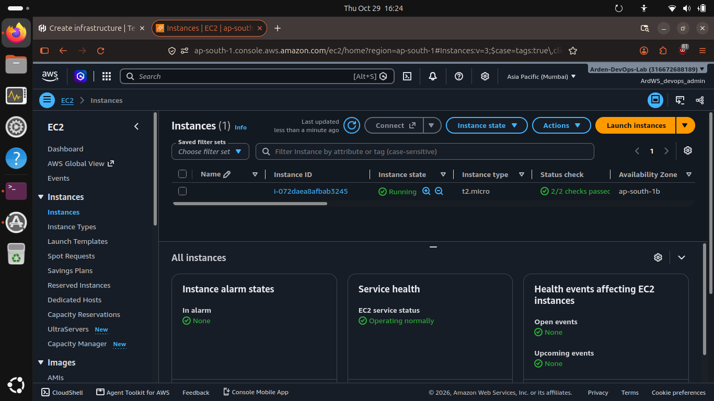

# Terraform-Practice-Repository
Hi, this is a Repository that highlight the exercises carried out for understanding Terraform.
<br>
<br>

# Terraform_Create:
Step-1: Paste the following files in a empty directory in your Linux terminal
<br>
<br>

Step-2: Perform terraform init:-
```bash
terraform init                                                                              
```
<br>
<br>

Step-3: Perform terraform plan ( for review ):-
```bash
terraform plan
```
<br>
<br>

Step-4: Perform terraform apply ( builds the required infra in the cloud [AWS] ):-
```bash
terraform apply
```
<br>



<br>

Notes:- Please use your own personal Pem-Key in place of the one already in use in main.tf, also please use your own region in the provider.tf file
<br>
<br>
<br>
<br>

# Managing_Terraform:
Step-1: Paste the following files in a empty directory in your Linux terminal.
<br>
<br>

Step-2: Configure the variables mentioned in the variable.tf file in the main.tf file.
e.g:
```bash
# instance type = t2.micro ❌
instance type = var.instance_type ✅
```
<br>
<br>

Step-3: Read the output.tf file to understand how outputs get shared during 'apply' done
```bash
output "instance_hostname" {
  description = "Will higlight the private DNS name of the instance created"
  value       = aws_instance.app_server.private_dns
}
```
<br>
<br>

Step-4: Observe the module used in main.tf. 
Modules: modules work as a pre-established repository that one can use instead of manually coding the infrastructure, most modules can be taken remotely form the Hashicorp Registry but modules can also be created & fetched locally.
```bash
module "vpc" {
  source  = "terraform-aws-modules/vpc/aws"
  version = "5.19.0"

  name = "example-vpc"
  cidr = "10.0.0.0/16"

  azs             = ["ap-south-1a", "ap-south-1b", "ap-south-1c"]
  private_subnets = ["10.0.1.0/24", "10.0.2.0/24"]
  public_subnets  = ["10.0.101.0/24"]

  enable_dns_hostnames = true
}
```
<br>
<br>

Step-5: Execute 'terraform fmt', then 'terraform init' & then 'terraform plan' to set & review the IaC setup for 'apply'
```bash
terraform fmt
terraform init
terraform plan
```
<br>
<br>

Step-6: Finally execute the apply operation & observe the output.
```bash
terraform apply
```
<br>

Note: This folder is used to help understand how variables, outputs & modules work & contribute towards building the cloud infrastructure using terraform.
<br>
<br>
<br>
<br>

# Terraform_Destroy
Step-1: First execute the following set of commands, once you place these files in a new empty directory.
```bash
terraform fmt
terraform init
terraform plan
terraform apply
```
<br>
<br>

Step-2: You should observe that a S3 bucket has been created, you can then proceed the comment the following lines of code in the main.tf file.
<br>


```bash
/*

resource "aws_s3_bucket" "example" {
  bucket = "bucky-is-bucket1999"

  tags = {
    Name = "Terraform-learn-buck"
  }
}
.
.
.
  depends_on = [aws_s3_bucket_public_access_block.secure_bucket_pab]
}

*/
```
<br>
<br>

Step-3: Then execute 'terraform apply' again & then observe the instructions as terraform removes the S3 bucket, then you can proceed to execute 'terraform destroy'
```bash
# -- Execute 'apply' to see how the S3 bucket specifically gets deleted by terraform in AWS
# terraform apply

# Then execute 'terraform destroy' to destroy the entire infrastructure in AWS
terraform destroy
```
<br>

Note: when creating a S3 bucket, remember to give it a good bucket name as S3 buckets can be only given a original identifier, using a already used name will lead to it getting rejected during the building process. Also don't forget to review the S3 build code to understand how the AWS S3 bucket was built.
<br>
<br>
<br>
<br>

# HCP_Terraform
Step-1: First, login into HCP Terraform using this link https://app.terraform.io/login/new
<br>
<br>

Step-2: Once, logged-in, create an organization, give it a proper name, then once you're done, you need to set your AWS Access Key & Secret Key into the workspace variables trough the Workspace variables via Workspace page portal.
<br>


<br>


<br>
<br>

Step-3: Make the following changes to your terraform.tf file that helps with access to the HCP platform.
```bash
terraform {
  cloud {
    organization = "your-organization-name"

    workspaces {
      project = "Learn Terraform"
      name = "learn-terraform-aws-get-started"
    }
  }

  required_providers {
    aws = {
      source  = "hashicorp/aws"
      version = "~> 5.92"
    }
  }

  required_version = ">= 1.2.0"
}

```
<br>
<br>

Step-4: execute terraform login & then generate a session token to access the HCP Terraform platform via CLI.
```bash
terraform login
# They will ask for confirmation, type yes to move ahead & don't forget to use your authentication token generated to successfully complete the login
```
<br>

This should be how your output should workout.
```bash
Retrieved token for user YOU


---------------------------------------------------------------------------------

                                        -                                
                                        -----                           -
                                        ---------                   --
                                        ---------  -                -----
                                        ---------  ------       -------
                                            -------  ---------  ----------
                                                ----  ---------- ----------
                                                --  ---------- ----------
   Welcome to HCP Terraform!                    -  ---------- -------
                                                    ---  ----- ---
   Documentation: terraform.io/docs/cloud           --------   -
                                                    ----------
                                                    ----------
                                                    ---------
                                                        -----
                                                            -


   New to HCP Terraform? Follow these steps to instantly apply an example configuration:

   $ git clone https://github.com/hashicorp/tfc-getting-started.git
   $ cd tfc-getting-started
   $ scripts/setup.sh
```
<br>
<br>

Step-5: Once the login is a success, you can then proceed to execute the following commands in your CLI.
```bash
terraform init
terraform plan
terraform apply
```
<br>

If you check back in your HCP Terraform platform, you can observe that the project will now be set & created in the project, allowing users to use HCP to archive & collaborate their cloud work using Terraform.

<br>

Step-6: Execute terraform destroy to remove the underlying infrastructure in Terraform & HCP, also do not forget to remove the project & organization from your HCP Terraform account.
```bash
terraform destroy
```
<br>
<br>
<br>

####### THE END ######
